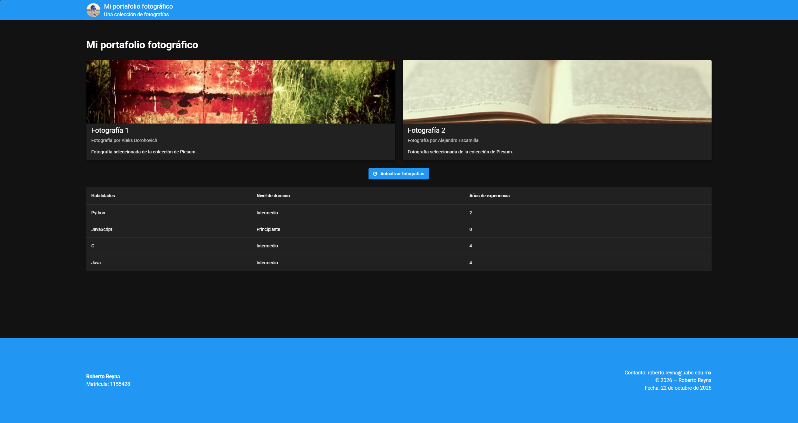

# Portafolio Fotográfico

Aplicación web desarrollada con Vue 3 y Vuetify para mostrar un portafolio fotográfico mediante tarjetas de imágenes obtenidas de la API de [Picsum Photos](https://picsum.photos/). Incluye información del autor de cada fotografía, un botón para actualizar las imágenes y una tabla con habilidades técnicas.

## Captura de pantalla

La siguiente imagen muestra la aplicación en funcionamiento:



## Características

- Visualización de fotografías mediante tarjetas de Vuetify.
- Obtención de imágenes y autores desde Picsum Photos API.
- Selección aleatoria de dos fotografías diferentes.
- Botón para actualizar las fotografías sin recargar la página.
- Indicador de carga durante las solicitudes a la API.
- Mensaje de error si no se pueden obtener las fotografías.
- Tabla de habilidades técnicas con nivel de dominio y años de experiencia.
- Encabezado y pie de página con información del portafolio.
- Diseño adaptable a diferentes tamaños de pantalla.

## Tecnologías utilizadas

- **Vue 3:** framework de JavaScript para construir interfaces de usuario.
- **TypeScript:** lenguaje con tipado estático utilizado en el proyecto.
- **Vuetify:** biblioteca de componentes de interfaz de usuario.
- **Vite:** herramienta para el desarrollo y la compilación de la aplicación.
- **Picsum Photos API:** servicio utilizado para obtener fotografías y sus autores.
- **pnpm:** administrador de paquetes.

## Instalación y ejecución

### Requisitos previos

- Node.js compatible con las dependencias del proyecto.
- pnpm instalado.
- Conexión a Internet para obtener las fotografías de la API.

### 1. Clonar el repositorio

```bash
git clone https://github.com/RAReyna/Meta-2.1_Interfaz-de-usuario-con-Vuetify.git
cd Meta-2.1_Interfaz-de-usuario-con-Vuetify/vuetify-project
```

### 2. Instalar las dependencias

```bash
pnpm install
```

### 3. Iniciar el servidor de desarrollo

```bash
pnpm run dev
```

Abre en el navegador la dirección local que muestre la terminal. Según la configuración del proyecto, normalmente será:

http://localhost:3000

### 4. Compilar para producción

```bash
pnpm run build
```

## Uso de la aplicación

1. Abre la aplicación en el navegador.
2. Consulta las fotografías mostradas en las tarjetas.
3. Revisa el autor asociado a cada fotografía.
4. Presiona **Actualizar fotografías** para solicitar una nueva selección aleatoria.
5. Consulta la tabla de habilidades técnicas en la parte inferior de la página.

Las fotografías y sus metadatos se obtienen mediante solicitudes HTTP a Picsum Photos. Se requiere conexión a Internet para recuperar estos datos.

## Estructura del proyecto

```text
Meta-2.1_Interfaz-de-usuario-con-Vuetify/
├── 2.1-evidencia.png
├── README.md
└── vuetify-project/
    ├── AGENTS.md
    ├── env.d.ts
    ├── index.html
    ├── package.json
    ├── pnpm-lock.yaml
    ├── tsconfig.json
    ├── tsconfig.app.json
    ├── tsconfig.node.json
    ├── vite.config.mts
    ├── public/
    │   ├── favicon.ico
    │   └── layers.css
    └── src/
        ├── App.vue
        ├── main.ts
        ├── assets/
        ├── components/
        │   ├── AppFooter.vue
        │   ├── AppHeader.vue
        │   ├── TablaDeDatos.vue
        │   └── TarjetaConImagen.vue
        ├── pages/
        │   └── index.vue
        ├── plugins/
        │   ├── index.ts
        │   └── vuetify.ts
        └── styles/
            └── settings.scss
```

## Descripción de los componentes

| Archivo | Responsabilidad |
|---|---|
| `App.vue` | Integra el encabezado, el contenido principal y el pie de página. |
| `AppHeader.vue` | Muestra el encabezado del portafolio. |
| `AppFooter.vue` | Presenta información del estudiante, contacto y fecha. |
| `TarjetaConImagen.vue` | Muestra una fotografía con su título, descripción y autor mediante propiedades (`props`). |
| `TablaDeDatos.vue` | Presenta las habilidades técnicas en una tabla. |
| `pages/index.vue` | Gestiona la consulta a Picsum Photos API, la selección de imágenes, el estado de carga y los errores. |
| `main.ts` | Inicializa Vue, registra los plugins y monta la aplicación. |
| `plugins/vuetify.ts` | Configura Vuetify. |
| `env.d.ts` | Contiene declaraciones de tipos para el entorno de desarrollo y los componentes Vue. |

## Autor

**Roberto Alonso Reyna Arvizu**

Proyecto académico desarrollado como práctica de componentes, composición de interfaces y consumo de una API externa con Vue y Vuetify.